```{=html}
<div class="news-v38-page">

<section class="news-v38-hero">
  <div class="news-v38-inner news-v38-hero-grid">
    <div>
      <span class="news-v38-kicker">NEWS &amp; HIGHLIGHTS</span>
      <h1>Research in motion</h1>
      <p>Selected publications, collaborations, team milestones and scientific events from the Cressiot nanopore research programme.</p>
    </div>
    <div class="news-v38-year">2026</div>
  </div>
</section>

<section class="news-v38-section">
  <div class="news-v38-inner">
    <div class="news-v38-section-heading">
      <div>
        <span class="news-v38-section-label">LATEST UPDATES</span>
        <h2>Highlights from 2026</h2>
      </div>
      <p>Recent publications, scientific presentations, outreach and collaborations.</p>
    </div>


    <div class="site-v66-news-feature">
      <article class="news-v38-card" id="fete-science-2026">
        <div class="site-v66-gallery">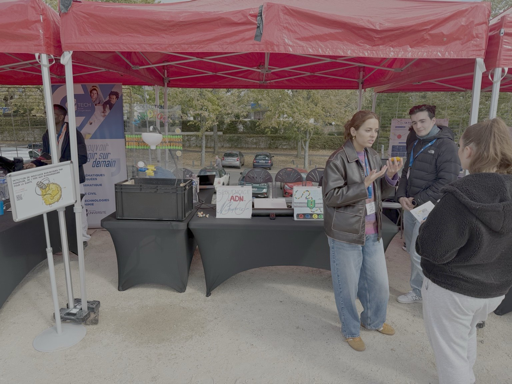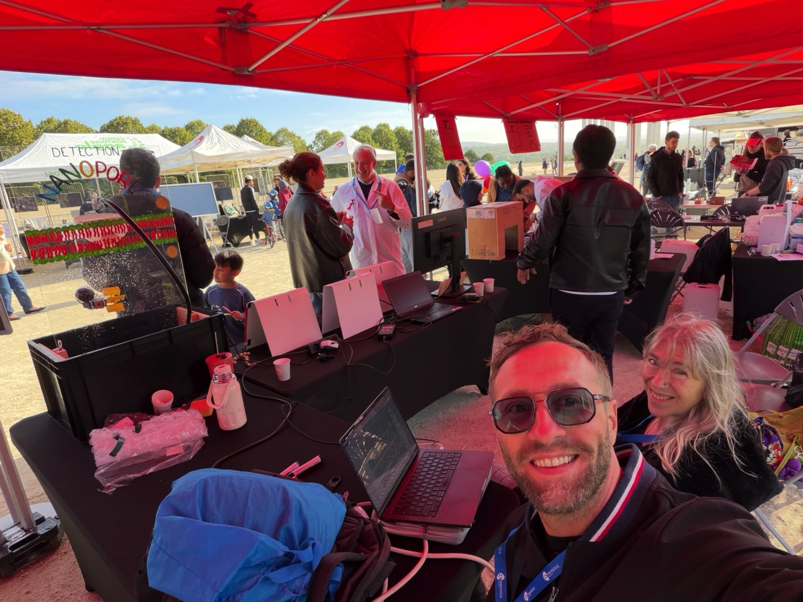</div>
        <div class="news-v38-content"><div class="news-v38-meta"><span>SCIENCE OUTREACH</span><time datetime="2026-10-10">10 October 2026</time></div><h3>Fête de la Science: introducing nanopore sensing to the public</h3><p>Our team presented an interactive workshop and conceptual demonstration of nanopores and the electrical detection of biomolecules. Visitors explored how single molecules can be detected through changes in ionic current, with discussions about biomedical applications.</p></div>
      </article>
      <article class="news-v38-card" id="cyu-novo-2026">
        <div class="news-v38-image news-v38-image-cover">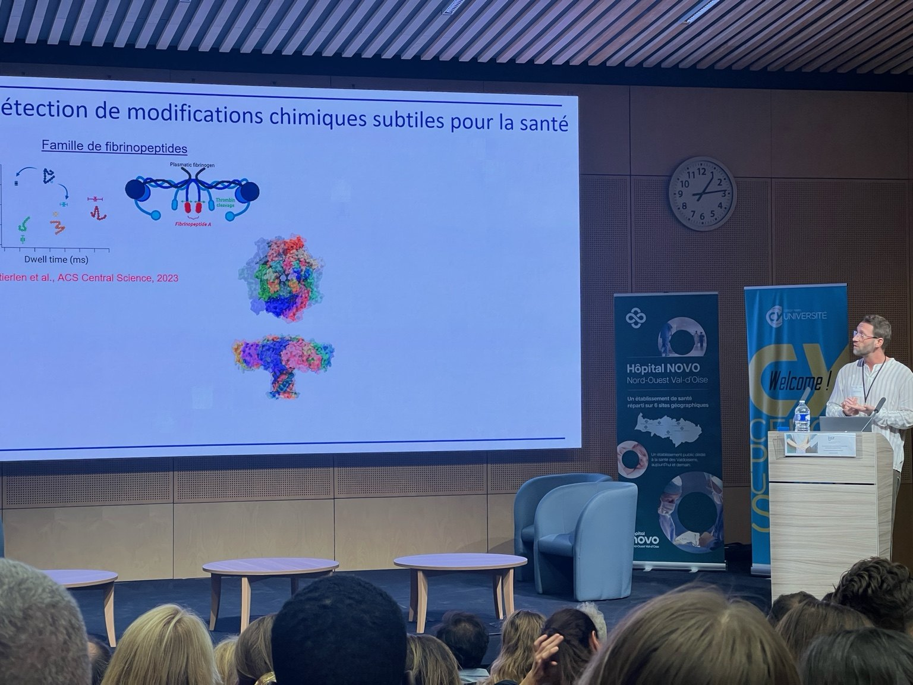</div>
        <div class="news-v38-content"><div class="news-v38-meta"><span>CONFERENCE &amp; COLLABORATION</span><time datetime="2026-10-02">2 October 2026</time></div><h3>Nanopore research at the first CYU–Hôpital NOVO health meeting</h3><p>At the first CY Cergy Paris Université–Hôpital NOVO meeting, “Innovating Together for Health”, Benjamin Cressiot delivered a talk on the detection and identification of protein biomarkers by nanopores. The team also contributed five posters on peptide biomarkers, proline isomers, enantiomers and sensing in complex biofluids.</p></div>
      </article>
      <article class="news-v38-card" id="small-methods-2026">
        <div class="news-v38-image">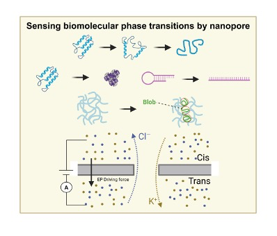</div>
        <div class="news-v38-content"><div class="news-v38-meta"><span>PUBLICATION · ACCEPTED</span><time>2026</time></div><h3>New review accepted in Small Methods</h3><p>Y. Cai, Y. Liu, L. Bacri, B. Cressiot* and J. Pelta* review how nanopores probe conformational and phase transitions in nucleic acids, proteins and polymers at the single-molecule level. DOI to be added after publication.</p><a href="publications.qmd">See publication record →</a></div>
      </article>
    </div>

    <div class="news-v38-feature-grid">
      <article class="news-v38-card">
        <div class="news-v38-image news-v38-image-contain">
          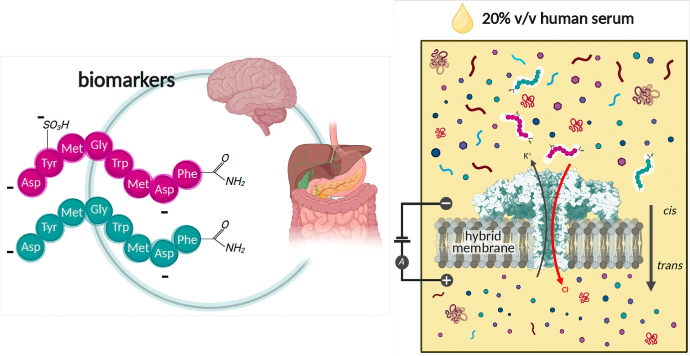
        </div>
        <div class="news-v38-content">
          <div class="news-v38-meta"><span>PUBLICATION</span><time>3 August 2026</time></div>
          <h3>Gut-hormone biomarkers resolved in human serum</h3>
          <p>Published in <em>Small</em>, this study demonstrates discrimination of sulfated and unsulfated CCK-8 biomarkers in 20% human serum.</p>
          <a href="https://doi.org/10.1002/smll.74968">View publication <span aria-hidden="true">→</span></a>
        </div>
      </article>

      <article class="news-v38-card news-v38-card-large">
        <div class="news-v38-image news-v38-image-cover">
          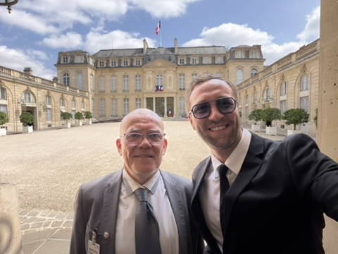
        </div>
        <div class="news-v38-content">
          <div class="news-v38-meta"><span>INNOVATION &amp; TRANSFER</span><time>23 July 2026</time></div>
          <h3>Nanopore diagnostics discussed at the Élysée Palace</h3>
          <p>Benjamin Cressiot and Pierre Defrenaix (Excilone) met at the Palais de l’Élysée to discuss the future of DreamPore, a startup hosted at CY Cergy Paris Université, and the development of nanopore-based molecular diagnostics.</p>
          <a href="funding-collaborations.qmd">Funding & innovation <span aria-hidden="true">→</span></a>
        </div>
      </article>
    </div>

    <div class="news-v38-grid">
      <article class="news-v38-card news-v38-card-large">
        <div class="news-v38-image news-v38-image-contain">
          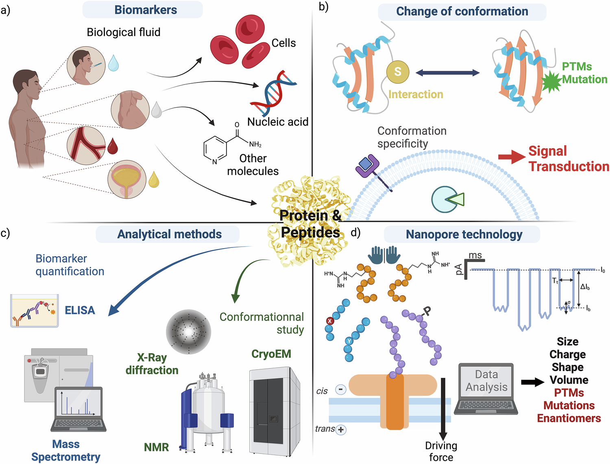
        </div>
        <div class="news-v38-content">
          <div class="news-v38-meta"><span>PUBLICATION</span><time>2026</time></div>
          <h3>New work published in Nature Communications</h3>
          <p>A study of scaling laws for polymer transport in confined media, with implications for nanopore-based biomarker detection.</p>
          <a href="publications.qmd">Explore the publication record <span aria-hidden="true">→</span></a>
        </div>
      </article>

      <article class="news-v38-card news-v38-card-programmes">
        <div class="news-v38-programme-logos" aria-label="Research programme logos">
          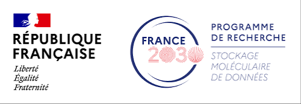
          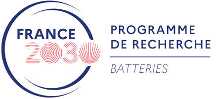
          
        </div>
        <div class="news-v38-content">
          <div class="news-v38-meta"><span>COLLABORATIONS</span><time>2026</time></div>
          <h3>Research networks spanning health, molecular data and energy</h3>
          <p>Ongoing participation in PEPR MolecularXiv, PEPR SENSIGA and the PROMETHEUS ecosystem broadens the reach of nanopore science.</p>
          <a href="funding-collaborations.qmd">Explore programmes <span aria-hidden="true">→</span></a>
        </div>
      </article>

      <article class="news-v38-card news-v38-card-team">
        <div class="news-v38-team-strip">
          
          
          
          <div class="news-v38-team-count"><strong>3</strong><span>Master 1 students</span></div>
        </div>
        <div class="news-v38-content">
          <div class="news-v38-meta"><span>TEAM</span><time>2026</time></div>
          <h3>The research team continues to grow</h3>
          <p>Postdoctoral researcher Soching LUIKHAM, recruited in October 2025 to work on synthetic-polymer detection and molecular information reading, joins doctoral researchers Laura Ratinho and Luca Iesu; the team also welcomes Mélanie De Magalhaes, Kalifa Sidibé and Ilies Hakimi in 2026.</p>
          <a href="team.qmd">Meet the team <span aria-hidden="true">→</span></a>
        </div>
      </article>

      <article class="news-v38-card">
        <div class="news-v38-image news-v38-image-contain">
          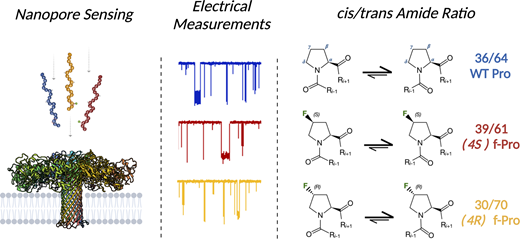
        </div>
        <div class="news-v38-content">
          <div class="news-v38-meta"><span>PUBLICATIONS</span><time>2025</time></div>
          <h3>Two contributions in Chemical Science</h3>
          <p>New results strengthen the programme on molecular discrimination, peptide structure and nanopore transport.</p>
          <a href="publications.qmd">See publications <span aria-hidden="true">→</span></a>
        </div>
      </article>

      <article class="news-v38-card">
        <div class="news-v38-image news-v38-image-contain">
          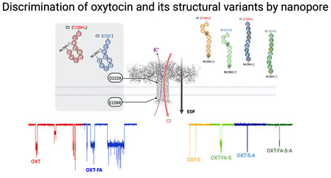
        </div>
        <div class="news-v38-content">
          <div class="news-v38-meta"><span>PUBLICATION</span><time>2025</time></div>
          <h3>Single-molecule peptide sensing in ACS Nano</h3>
          <p>The work expands the ability of nanopores to distinguish closely related peptide structures and biologically relevant variants.</p>
          <a href="publications.qmd">Read the research highlights <span aria-hidden="true">→</span></a>
        </div>
      </article>
    </div>
  </div>
</section>

<section class="news-v38-section" aria-labelledby="outreach-2025-title">
  <div class="news-v38-inner">
    <div class="news-v38-section-heading">
      <div><span class="news-v38-section-label">SCIENCE OUTREACH · 2025</span><h2 id="outreach-2025-title">Public lecture · March 2025</h2></div>
      <p>Bringing single-molecule science and biomedical research to a wider audience.</p>
    </div>
    <article class="site-v67-video-feature" id="universite-ouverte-2025">
      <div class="site-v67-video-copy">
        <span class="news-v38-section-label">UNIVERSITÉ OUVERTE · 27 MARCH 2025</span>
        <h3>Nanopores: analytical tools for the early diagnosis of diseases</h3>
        <p>In this public lecture at CY Cergy Paris Université, Benjamin Cressiot explains how nanopores detect biomolecules one at a time and how this technology could contribute to earlier disease diagnosis. The talk introduces electrical nanopore sensing, biomarker detection in biological samples, and potential applications in healthcare, environmental monitoring and energy research.</p>
        <p><strong>Original French title:</strong> <em>Les nanopores : des outils d’analyse pour le diagnostic précoce de maladies</em>.</p>
        <p><a href="https://universiteouverte.u-cergy.fr/les-nanopores-des-outils-danalyse-pour-le-diagnostic-precoce-de-maladies/" target="_blank" rel="noopener noreferrer">Official Université Ouverte lecture page ↗</a><br><a href="https://www.youtube.com/watch?v=Crnr5xbU6sA" target="_blank" rel="noopener noreferrer">Watch on YouTube ↗</a></p>
      </div>
      <div class="site-v67-video-embed">
        <iframe src="https://www.youtube-nocookie.com/embed/Crnr5xbU6sA" title="Les nanopores : des outils d’analyse pour le diagnostic précoce de maladies — Université Ouverte, 27 March 2025" loading="lazy" referrerpolicy="strict-origin-when-cross-origin" allow="accelerometer; autoplay; clipboard-write; encrypted-media; gyroscope; picture-in-picture; web-share" allowfullscreen></iframe>
      </div>
    </article>
  </div>
</section>

<section class="news-v38-closing">
  <div class="news-v38-inner">
    <div>
      <span class="news-v38-section-label">FOLLOW THE RESEARCH</span>
      <h2>Reading molecular information, one molecule at a time.</h2>
    </div>
    <div class="news-v38-actions">
      <a class="news-v38-button news-v38-button-primary" href="publications.qmd">Publications</a>
      <a class="news-v38-button" href="contact.qmd">Contact</a>
    </div>
  </div>
</section>

</div>
```
